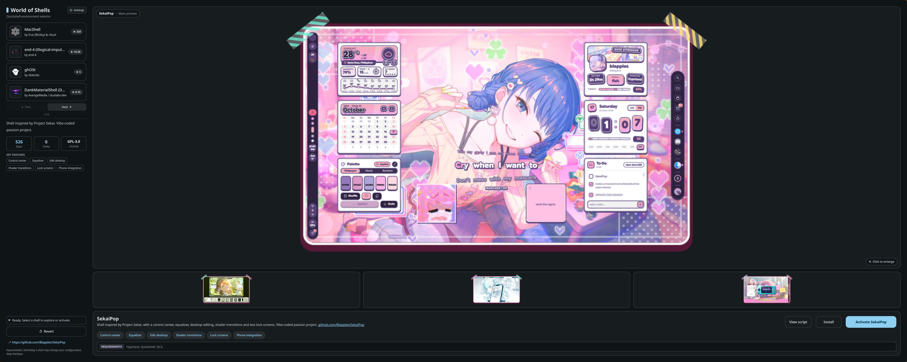
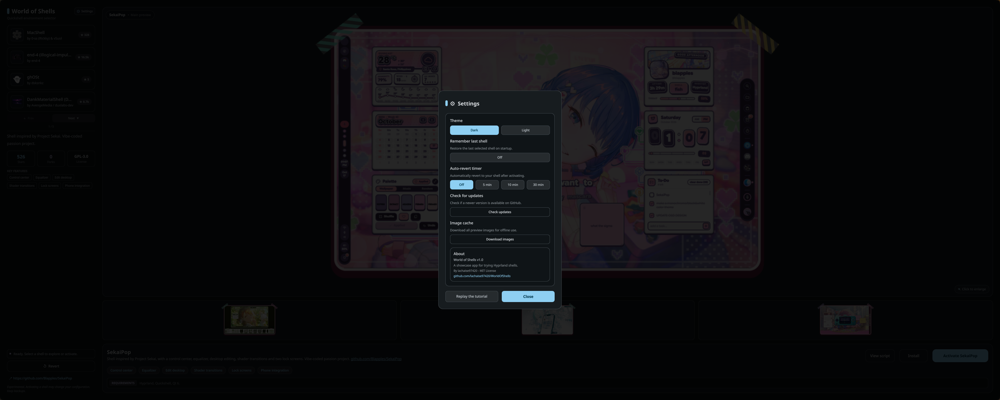
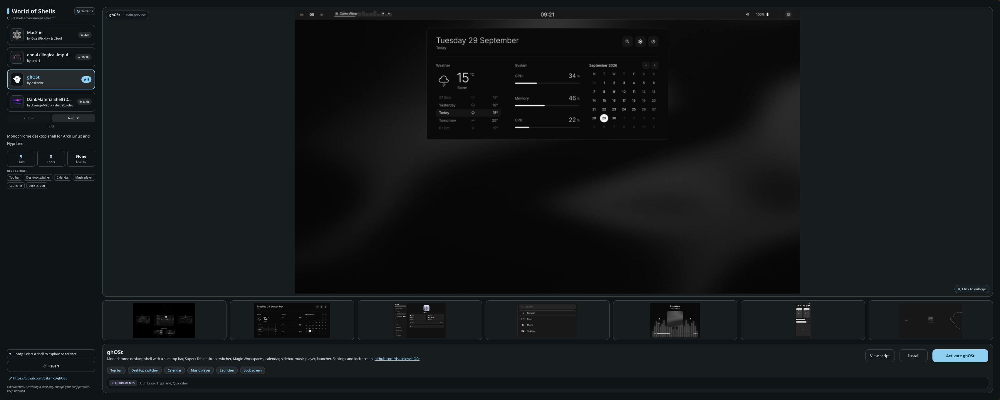

# World of Shells


## Disclaimer

**This project is highly experimental.** I am not a developer — just someone in their room with a PC and internet access. This app is a showcase/vitrine for trying different Hyprland shells. Activating a shell may modify your system configuration. Always ensure you have backups of your Hyprland and Quickshell configs before trying a shell. I am not responsible for any damage to your system configuration.

Some shells (like end-4) perform full dotfiles installations that may overwrite your existing configuration. Use at your own risk.


## Screenshots





A showcase app for trying different Hyprland shells. Built with Quickshell.

## Installation

```bash
git clone https://github.com/lachaise97420/WorldOfShells.git
bash install.sh
```

Or manually:
```bash
cp -r WorldOfShells-standalone ~/.config/quickshell/WorldOfShells
chmod +x ~/.config/quickshell/WorldOfShells/*.sh
```

## Usage

```bash
qs -c WorldOfShells
```

Or find "World of Shells" in your app launcher.

## Shells included (21)

| Shell | Stars | License | Activation |
|-------|-------|---------|------------|
| MacShell | 328 | MIT | Start qs -c MacShell |
| end-4 (illogical-impulse) | 16.5k | GPL-3.0 | Full dotfiles install (confirmation required) |
| ghOSt | 5 | None | ghost start |
| DankMaterialShell (DMS) | 8.7k | MIT | Start dms run |
| Nucleus Shell | 721 | GPL-3.0 | Start qs -c nucleus-shell |
| Nandoroid | 179 | AGPL-3.0 | Start qs -c nandoroid |
| SekaiPop | 526 | GPL-3.0 | Start qs -c sekaipop |
| Twinshell | 5 | GPL-3.0 | Start qs -c twinshell |
| QSDots | 5 | MIT | Start qs -c qsdots |
| Asaki Shell | 0 | Unknown | Start qs -c asaki |
| MaterialUI | 0 | MIT | Start qs -c materialui |
| Vantage | 24 | MIT | Start qs -c vantage |
| Ukishima | 119 | MIT | Start qs -c ukishima |
| Lucid | 322 | MIT | Start qs -c lucid |
| Nothingshell | 26 | MIT | Start qs -c nothingshell |
| NibrasShell |  |  | Start qs -c nibras |
| Impasto |  |  | Start qs -c impasto |
| CuteShell | 17 | GPL-3.0 | Start qs -c cuteshell |
| Minflair | 212 | GPL-3.0 | Start qs -c minflair |
| Tripathi Quickshell | 196 | MIT | Start qs -c trip |
| Serpantinum | 7.6k | AGPL-3.0 | serpantinumd start |

## Installing a shell

Install clones the shell's repo and runs its own installer in a terminal. View script fetches that installer from the repo first. Shells with no script in their repo have neither.

## Features
- Browse 21 shells with screenshots
- Click "Activate" to try an installed shell (stops current, starts new one)
- Click "Revert" to stop it and restore ghOSt
- Image lightbox with zoom/pan
- Matugen-friendly (reads colors from ~/.cache/ryoku/colors.json if available)
- Settings button (placeholder)

## Requirements
- Hyprland 0.55+
- Quickshell 0.3.0+
- Qt 6.5+
- qsb (qt6-shadertools)


## Contributing

Want to add a shell? See [CONTRIBUTING.md](CONTRIBUTING.md) for a step-by-step guide.


## Changelog

See [CHANGELOG.md](CHANGELOG.md) for a full list of changes.

## License
MIT

## Disclaimer

**This project is highly experimental.** It is a showcase/vitrine application for trying different Hyprland shells. Activating a shell may modify your system configuration. Always ensure you have backups of your Hyprland and Quickshell configs before trying a shell. The authors are not responsible for any damage to your system configuration.

Some shells (like end-4) perform full dotfiles installations that may overwrite your existing configuration. Use at your own risk.
